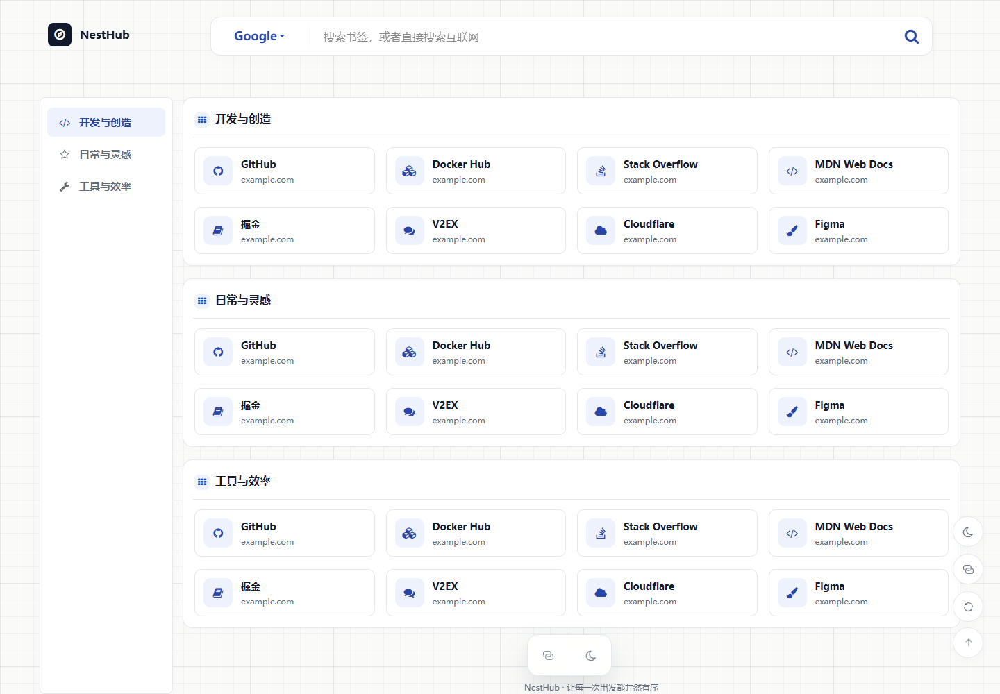

# NestHub

把常用网站收进自己的导航主页。NestHub 是可自托管的导航与书签管理工具，提供独立用户空间、公共导航、浏览器快捷收藏和 11 套中文主题。

[Docker 部署与迁移指南](docs/docker-deployment.md) · [浏览器插件说明](extensions/nesthub/README.md) · [镜像构建记录](https://github.com/sunnyfancore/NestHub/actions/workflows/docker.yml)

## 界面预览



经典主题采用细网格背景、浅色卡片与蓝色强调，桌面导航居中排列，每行最多四张卡片，并适配手机。[查看暗色效果](docs/assets/classic-dark.png)。

## Docker Compose 部署（推荐）

镜像：`ghcr.io/sunnyfancore/nesthub:latest`，支持 Linux AMD64 / ARM64。默认使用 SQLite，只运行一个 NestHub 容器并内置后台更新逻辑，无需安装 MySQL、Node.js 或 .NET。

### 1. 准备配置

在服务器新建一个部署目录，例如 `/srv/nesthub`。将下面内容保存为该目录中的 `docker-compose.yml`，不需要克隆整个仓库：

```yaml
name: nesthub
services:
  nesthub:
    container_name: ${NESTHUB_CONTAINER_NAME:-nesthub}
    image: ${NESTHUB_IMAGE:-ghcr.io/sunnyfancore/nesthub:latest}
    ports:
      - "${NESTHUB_BIND_ADDRESS:-0.0.0.0}:${NESTHUB_PORT:-5186}:8080"
    environment:
      ASPNETCORE_ENVIRONMENT: Production
      ASPNETCORE_URLS: http://+:8080
      TZ: ${TZ:-Asia/Shanghai}
      Database__Provider: Sqlite
      Database__ConnectionString: "Data Source=/app/AppData/nesthub.db"
      Database__AutoSyncStructure: "true"
      Jwt__SecretKey: ${JWT_SECRET:?Configure JWT_SECRET in .env}
      SuperAdmin__Email: ${ADMIN_EMAIL:-admin@example.com}
      SuperAdmin__Password: ${ADMIN_PASSWORD:?Configure ADMIN_PASSWORD in .env}
      SuperAdmin__DisplayName: 超级管理员
      Updates__Enabled: "true"
      Updates__ProxyUrl: ${UPDATE_PROXY_URL:-}
    volumes:
      - ./data/app:/app/AppData
    restart: unless-stopped

```

在同一目录新建 `.env`，填写以下内容，把示例值换成自己的密码与随机密钥：

```dotenv
ADMIN_EMAIL=admin@example.com
ADMIN_PASSWORD=请替换为自己的强密码
JWT_SECRET=请替换为至少32字符的随机密钥
NESTHUB_PORT=5186
NESTHUB_IMAGE=ghcr.io/sunnyfancore/nesthub:latest
UPDATE_PROXY_URL=
```

Linux 可用 `openssl rand -hex 32` 生成密钥。已有站点迁移时保留原 JWT 密钥；管理员配置用于初次创建账号，不会重置已有账号密码。

完整配置见 [.env.example](.env.example)。无法直连 GHCR 时，可自行选择镜像代理，例如设置 `NESTHUB_IMAGE=ghcr.dockerproxy.net/sunnyfancore/nesthub:latest`；可用性与同步速度由代理服务决定。只通过本机反向代理访问时，可设置 `NESTHUB_BIND_ADDRESS=127.0.0.1`。

### 2. 创建挂载目录并启动

需要 Docker Engine 和 Docker Compose v2。在上述部署目录运行：

```bash
mkdir -p data/app
sudo chown -R 1654:1654 data/app
docker compose up -d --wait --wait-timeout 300
```

访问 `http://服务器IP:5186`，使用 `.env` 中的邮箱和密码登录。首次启动自动创建数据库与表结构。对外使用域名时，建议通过反向代理配置 HTTPS。

想让脚本自动生成配置和密码，可使用仓库内的一键部署方式（Linux，需 Git、OpenSSL）：

```bash
git clone https://github.com/sunnyfancore/NestHub.git
cd NestHub
bash scripts/deploy.sh
```

### 3. 目录挂载说明

`./data/app` 指 **Compose 文件所在目录** 下的 `data/app`，不是容器内部目录。整个目录需要保留。

```text
/srv/nesthub/
├── docker-compose.yml
├── .env                       # 管理员配置与 JWT 密钥
├── data/
│   └── app/
│       ├── nesthub.db          # SQLite 数据库
│       ├── nesthub.db-wal      # 运行时可能存在，备份时一并保留
│       ├── nesthub.db-shm      # 运行时可能存在
│       ├── uploads/           # 上传的图片、Logo 等
│       └── updates/           # 应用版本、当前版本指针与更新状态
└── backups/                   # 可自行创建，用于备份
```

| 宿主机位置 | 容器位置 | 用途 |
| --- | --- | --- |
| `./data/app` | `/app/AppData` | 数据库、上传文件与应用更新版本，必须持久化 |
| `./data/mysql` | `/var/lib/mysql` | 仅 MySQL 部署使用 |
| `.env` | 不挂载，由 Compose 读取 | 密钥、密码等配置 |
| `./backups` | 默认不挂载 | 自己保存的备份文件 |

也可以改用绝对路径，例如将 `volumes` 改成：

```yaml
    volumes:
      - /srv/nesthub-data:/app/AppData
```

这时应创建 `/srv/nesthub-data`，并赋予 UID `1654` 写入权限。NAS 也可以使用自己的共享目录路径。不要挂载整个 `/app` 或 `/app/wwwroot`，否则会覆盖镜像中的程序，导致更新无效。

SQLite 适合个人和小团队的单实例部署；大量并发写入可选择 MySQL。MySQL 使用仓库中的独立配置 [docker-compose.mysql.yml](docker-compose.mysql.yml)，具体启动、外部数据库连接和迁移方法见 [部署指南](docs/docker-deployment.md)。切换数据库类型不会自动搬迁原数据。

## 更新与备份

### 后台点击更新（默认可用）

后台从 GitHub Releases 下载应用包，校验后在同一容器内切换程序并重启。无需 Docker socket、Watchtower 或额外更新容器。新版本启动失败时自动恢复旧程序；数据库结构不自动回滚，更新前请备份。

应用包包含后端、前端与插件 ZIP，不包含数据库或 .NET 运行环境。下载时网站可用，切换时短暂中断；更新会校验大小与 SHA-256，并在新程序启动后检查健康状态。

首次切换需要手动拉取一次新基础镜像并重建容器，移除旧 socket 挂载、`user: "0:0"` 和 `Updates__ContainerName`。数据目录须允许 UID 1654 写入。之后进入 **后台 → 应用更新**，可查看下载、校验、重启与健康检查进度。

旧部署保留原 `.env` 和数据目录，换用上述 Compose，等待新基础镜像发布并同步到所用代理后执行：

```bash
docker compose stop nesthub
# 先备份 .env 和整个 data/app
sudo chown -R 1654:1654 ./data/app
docker compose pull nesthub
docker compose up -d --no-deps --force-recreate --remove-orphans --wait --wait-timeout 300 nesthub
```

MySQL 部署命令需添加 `-f docker-compose.mysql.yml`。旧版额外更新容器应从 Compose 移除。

更新包默认直接从 GitHub 下载，可用 `Updates__ProxyUrl` 配置 HTTP / SOCKS5 代理。Docker 镜像代理只用于镜像，不会加速 GitHub 应用包。应用版本保存在 `AppData/updates`，重建容器会继续使用已更新版本；运行环境升级仍需更新基础镜像。完整说明见 [部署指南](docs/docker-deployment.md)。

上述 Compose 可在 `.env` 中设置 `UPDATE_PROXY_URL=http://代理地址:端口`，修改后重建容器。代理需能访问 GitHub API、Release 附件及其 CDN。

也可直接在 **后台 → 应用更新 → 下载网络** 选择直连、GHFast / GH-Proxy 附件加速预设，填写自定义加速地址或网络代理，测试后保存。页面配置立即生效并随数据目录保留，优先于环境变量。第三方预设以连接测试结果为准；附件加速不代理 GitHub API，详见部署指南。


### 基础镜像与运行环境更新

在部署目录运行，数据库和上传文件继续保留在挂载目录中：

```bash
docker compose pull nesthub
docker compose up -d --no-deps --wait --wait-timeout 300 nesthub
```

更新前备份 `.env` 和整个 `data/app`。SQLite 文件备份应先停止应用，复制完整目录后再启动，避免只复制正在写入的 `nesthub.db`。MySQL 备份与恢复、版本固定和回退见 [完整指南](docs/docker-deployment.md)。后台书签导出适合搬运书签，不等于整站备份。

日常版本使用下方的后台应用包更新；.NET 运行环境或系统组件升级时才需要更新基础镜像。**拉取镜像不会覆盖已启用的应用包**。恢复镜像内置程序的步骤见部署指南，旧程序未必兼容新版数据库结构。

### SQLite 备份示例

```bash
mkdir -p backups
docker compose stop nesthub
tar -czf backups/app-data.tar.gz -C data app
docker compose start nesthub
```

另行保存 `.env`。恢复时先停止应用、保留现有目录副本，再恢复完整数据目录并设置 UID `1654` 权限。MySQL 需另外进行数据库逻辑备份，见部署指南。

## 浏览器快捷收藏

支持 Chrome、Edge、Brave 等 Chromium 浏览器。登录后台进入 **获取 API**，下载插件压缩包并查看安装指引。

后台也提供 [Chrome 商店入口](https://chromewebstore.google.com/detail/anlhoeladccnfaehoinbofpjiakgiiff)，是否可安装及版本以商店审核发布状态为准。目前不提供 Firefox / Safari 安装包。

1. 解压压缩包，在浏览器扩展管理页开启“开发者模式”。
2. 点击“加载已解压的扩展程序”，选择包含 `manifest.json` 的目录。
3. 在插件中填写 NestHub 站点地址，使用 API 令牌连接；也可按插件提示读取同一浏览器中已登录站点的令牌。
4. 打开任意网页，通过插件或贴边收藏按钮选择分类并保存。

插件提供分类缓存、强制刷新、主题切换、可拖动的贴边按钮，以及可选的浏览器启动时打开导航主页。`Alt+Shift+B` 若未生效，可在浏览器扩展快捷键设置中重新绑定。远程站点请使用 HTTPS。

连接和启动导航共用一个站点地址。设置先调整，最后统一保存并申请所需权限；主题会同步到当前账号的导航设置。贴边按钮默认关闭，浏览器内部页和商店页面等受限页面无法显示。

当前认证使用 Bearer JWT，并非独立长期 API Key。插件不要求输入网站账号密码；读取登录状态需要同一浏览器配置文件，令牌过期后需重新连接。

每次构建发布网站和 Docker 镜像，都会自动打包最新插件供后台下载。**已安装的手动版插件需要自行下载新版并重新加载**；Chrome 商店发布是独立流程。详细操作见 [插件说明](extensions/nesthub/README.md)。

## 功能与主题

| 功能 | 说明 |
| --- | --- |
| 独立空间 | 多租户数据隔离，支持个人导航与公共展示 |
| 书签管理 | 分类、拖拽排序、置顶、标签、浏览器 HTML 导入 |
| 搜索导航 | 切换搜索引擎、搜索建议，支持单个字符查询 |
| 网站图标 | 自动识别网站图标并缓存，支持手动调整 |
| 分享与导出 | 分类分享支持密码、有效期与撤销；书签 JSON 与浏览器 HTML 导出。见[分享说明](docs/bookmark-sharing.md) |
| 管理后台 | 用户与租户、分类、链接、主题、SMTP 和应用更新 |
| 设备适配 | 桌面与移动端布局，亮色与暗色模式 |

网站与插件共享 11 套中文主题，经典排在第一位。部分主题提供动态背景，并适配系统的减少动态效果偏好。

| 主题 | 风格 |
| --- | --- |
| 经典 · 简洁导航 | 细网格背景、蓝色强调与居中卡片 |
| 海洋 · 蔚蓝清爽 | 清爽蓝色与海洋光影 |
| 霓虹 · 未来科技 | 霓虹色彩与科技氛围 |
| 纸笺 · 温润书卷 | 温暖纸色与阅读感 |
| 樱糖 · 二次元粉色 | 粉色配色、星星飘落与双列分类宫格 |
| 青柠 · 清新自然 | 明亮青柠色与双列分类宫格 |
| 曜金 · 高级黑金 | 深色底与金色强调，可展开的窄图标导航 |
| 流光 · 液态玻璃 | 透明层次与流动光影 |
| 网址簿 · 经典目录 | 集中浏览网址的目录布局 |
| 效率台 · 侧栏工作台 | 侧栏分类与工作导航 |
| 起始页 · 极简导航 | 居中内容与横向分类标签，移动端标签可横向滑动 |

## 源码开发

仅源码开发需要安装 **.NET 10 SDK** 和 **Node.js 24**（Vite 最低支持 Node.js 22.12）。使用 SQLite 开发时无需 MySQL。

复制 `src/NestHub.Api/appsettings.json` 为 `src/NestHub.Api/appsettings.Development.json`，修改以下配置，保留模板中其他字段：

```json
{
  "Database": {
    "Provider": "Sqlite",
    "ConnectionString": "Data Source=AppData/nesthub.db",
    "AutoSyncStructure": true
  },
  "SuperAdmin": {
    "Email": "admin@example.com",
    "Password": "请替换为自己的强密码",
    "DisplayName": "超级管理员"
  },
  "Jwt": {
    "Issuer": "NestHub.Api",
    "Audience": "NestHub.Web",
    "SecretKey": "请替换为至少32字符的随机密钥",
    "ExpireHours": 720
  }
}
```

本地 SQLite 相对路径以 API 内容目录为准。开发配置不应提交到仓库。

在项目根目录启动后端（会构建前端）：

```bash
dotnet run --project src/NestHub.Api
```

访问 `http://localhost:5186`。需要前端热更新时，另开终端运行：

```bash
cd src/NestHub.Web
npm ci
npm run dev
```

前端开发地址为 `http://localhost:5173`，已配置后端代理。

技术栈：ASP.NET Core 10、FreeSql、SQLite / MySQL、Vue 3、TypeScript、Vite、Pinia、Element Plus，使用 JWT 认证。

常用验证（项目根目录执行）：

```bash
npm run build --prefix src/NestHub.Web
dotnet run --project tests/NestHub.SmokeTests -p:SkipFrontendBuild=true
```

## 构建与发布

推送 `main` 后，GitHub Actions 自动构建网站、后端与插件，验证 SQLite、MySQL、迁移和数据持久化，再发布 AMD64 / ARM64 镜像到 GHCR。主分支发布 `latest` 与提交版本标签；`v*` 标签用于版本发布。构建记录见 [Docker 工作流](https://github.com/sunnyfancore/NestHub/actions/workflows/docker.yml)。

主分支同时发布 GitHub Releases 应用包：`app-<完整提交号>`，包含 Linux x64 / ARM64 ZIP 与校验清单。全部附件上传后才公开为预发布版本，后台不使用未完成的草稿。流水线还验证应用包更新和失败回退；应用包发布仅在 `main` 运行，标签构建不覆盖 `latest`。插件商店提交审核是独立流程。

前端采用按需组件与弹窗加载、自托管图标字体；服务端压缩前端资源、缓存静态文件，并优化点击统计与数据库查询。实现和测量范围见 [性能说明](docs/performance.md)。

| 目录 / 文件 | 内容 |
| --- | --- |
| `src/NestHub.Api` | 后端接口、数据库与业务服务 |
| `src/NestHub.Web` | 网站与管理后台 |
| `extensions/nesthub` | 浏览器插件 |
| `docker-compose.yml` | 默认 SQLite 部署 |
| `docker-compose.mysql.yml` | MySQL 部署 |
| `docker-compose.update.yml` | 旧版叠加配置，新部署无需使用 |
| `docs/docker-deployment.md` | 部署、挂载、迁移、更新、备份与恢复 |
| `docs/performance.md` | 性能优化实现与测量范围 |
| `.env.example` | 部署环境变量模板 |

## 常见问题

| 问题 | 检查方法 |
| --- | --- |
| 无法访问站点 | 检查端口、防火墙与容器状态 |
| 数据目录无法写入 | 检查挂载路径与 UID `1654` 写入权限 |
| 后台更新不可用 | 升级支持应用包的新基础镜像，确认启用更新且可访问 GitHub |
| 下载慢 | 配置应用下载代理；镜像代理不加速 GitHub Release |
| 更新镜像后版本没变 | 已启用应用包会持久化，按更新指南处理 |
| 插件没有最新功能 | 手动版需下载新版并重新加载；商店版以审核发布版本为准 |
| 修改管理员环境密码无效 | 初始配置不重置已有账号，请在网站内修改密码 |

排查命令（部署目录执行）：

```bash
docker compose ps
docker compose logs --tail=100 nesthub
curl -f http://localhost:5186/health
```
